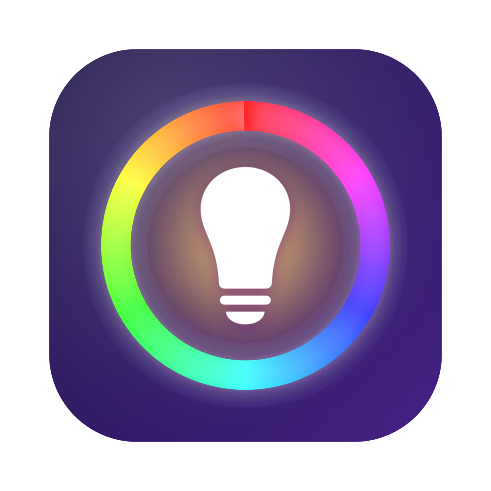

<p align="center"></p>

# HueBar

**Version 1.0.0** · by [Todd Dube](https://github.com/todddube) · [MIT License](LICENSE) · [github.com/todddube/huelights](https://github.com/todddube/huelights)

A native macOS menu bar app for Philips Hue. It finds your bridge automatically, pairs with
the link button, and gives you full control of lights, rooms, zones and scenes from a popup
under the menu bar icon. It also covers day-to-day bridge management: rename, firmware
updates, searching for new bulbs and removing devices.

## Features

- **Auto-discovery** over Bonjour (`_hue._tcp`), with the Hue cloud and manual IP as fallbacks.
- **Link-button pairing** with a 30 second countdown; the key is saved and reused across rebuilds.
- **Lights**: on/off, brightness, colour temperature (kelvin), full colour picker and presets,
  identify (blink), rename by double-clicking.
- **Rooms and zones**: group power and brightness, member lights, one-tap scenes.
- **Scenes** tab grouped by room, with the active scene highlighted.
- **Bridge** tab: name, id, address, firmware/API versions, Zigbee channel, firmware check
  and install, search for new lights, paired device list with removal, forget bridge.
- **Live updates** from the bridge's event stream, so changes made in the Hue app show up instantly.
- Menu bar icon fills in when any light is on; one-click all-on/all-off; launch at login.

## Building

### Xcode

Open `HueBar.xcodeproj` and run the `HueBar` scheme. The project is generated from
`project.yml` with [xcodegen](https://github.com/yonaskolb/XcodeGen); after adding files
outside Xcode, run `make xcodeproj`.

### Terminal (SwiftPM)

```bash
make app        # release build → build/HueBar.app
make run        # build and launch it
make install    # copy to /Applications
make test       # HueKit unit tests
HUEBAR_LIVE=1 make test   # also run discovery/TLS tests against the bridge on your LAN
swift run       # debug run without a bundle (no Dock icon either way)
```

The app bundle is ad-hoc signed and not sandboxed.

## Layout

```
HueBar/            SwiftUI app (App/, Store/, Views/, Assets.xcassets, Info.plist)
HueKit/            UI-free Swift package: models, discovery, HTTPS client, colour maths, tests
Resources/         Rendered icon assets (AppIcon.icns, AppIcon-1024.png, Logo.png)
scripts/           build-app.sh (bundle assembly), make-icons.swift (icon renderer)
project.yml        xcodegen spec for HueBar.xcodeproj
Package.swift      SwiftPM manifest for the app; HueKit/Package.swift for the library
backup/            The previous Python/Streamlit project, kept for reference (git-ignored)
```

## Where credentials live

Pairing writes `~/Library/Application Support/HueBar/bridges.json` (mode 0600) containing the
bridge id, address, application key, entertainment client key and the pinned certificate
fingerprint. Both the Xcode build and `swift run` read the same file, so you pair once and
keep working through rebuilds. Set `HUEBAR_CONFIG_DIR` to point somewhere else. "Forget
Bridge" deletes the file; to revoke the key on the bridge itself, remove HueBar under
Settings → Apps in the official Hue app.

## Security notes

Hue bridges use a certificate signed by Signify's private CA with the bridge id as its common
name. HueBar verifies that common name on first contact, pins the certificate's SHA-256
fingerprint, and refuses to send the application key to any other certificate afterwards.
The only call that accepts any certificate is the unauthenticated `/api/0/config` probe used
during discovery.

## Requirements

macOS 14 or later, Xcode 26 / Swift 6 to build.

## License

HueBar is free, open-source software released under the [MIT License](LICENSE).
Copyright © 2026 Todd Dube.
